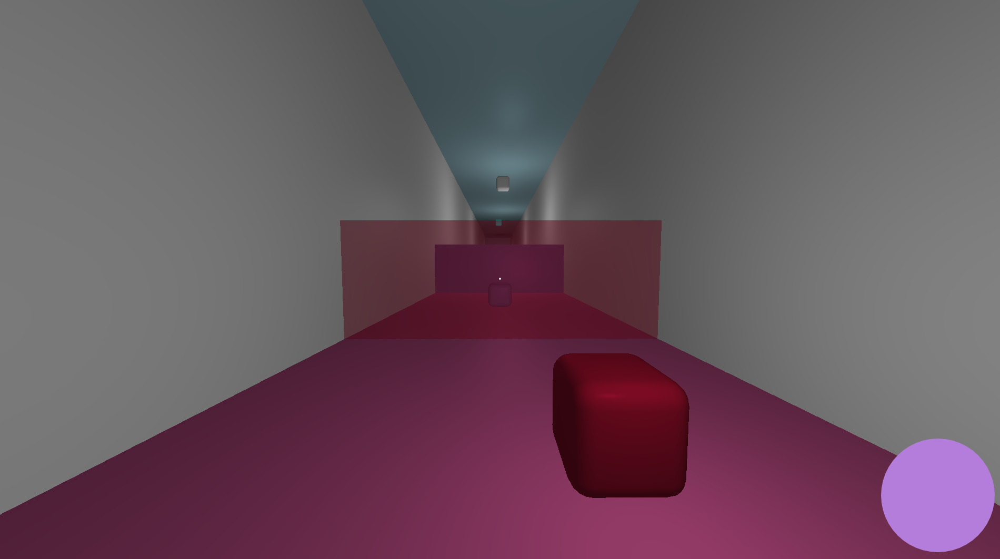

# Spectrum Retreat - FPS Puzzle Game

## About The Project

**Spectrum Retreat** is a first-person puzzle game developed as our First Year End of Year Project. Inspired by *The Spectrum Retreat* (2018), this game challenges players to navigate through color-based puzzles where your "phone" determines which doors and walls you can pass through.

The core mechanic revolves around swapping colors between your phone and interactive color cubes, allowing you to traverse doors matching your current phone color.



## Features

### Core Gameplay
- **First-person camera controller** (WASD / ZQSD movement, mouse look, space to jump)
- **Color-swapping mechanic** - Click on colored cubes to exchange their color with your phone
- **Color-based door system** - Doors disappear/allow passage when matching your phone color
- **Solid collision detection** - Walls and floors are properly solid
- **Ambient background music** - Looping soundtrack throughout gameplay
- **Level completion zone** - Triggers victory screen/teleportation

### Advanced Features
- **Moving interactive objects** - Objects following predetermined paths (reference: level 4_03)
- **Contextual sound effects** - Different audio feedback for player actions (target interaction, color swap)
- **Transparent doors** - 50% opacity when different color, 10% opacity when matching

### Technical Highlights
- **Custom mathematics library** - Built from scratch for vector/matrix operations
- **Modern OpenGL rendering** - 3.3+ Core Profile with Blinn-Phong shading (custom shader)
- **Multiple light types** - Point lights with proper attenuation (no full-level illumination)
- **Audio system** - irrKlang for sound effects and music
- **ImGui integration** - ESC menu with Restart/Quit options

## Tech Stack

| Category | Technologies |
|----------|-------------|
| **Language** | C++17 |
| **Graphics API** | [OpenGL](https://registry.khronos.org/OpenGL/) 3.3 Core ([GLAD](https://glad.dav1d.de/)) |
| **Windowing** | [GLFW](https://www.glfw.org/) |
| **Mathematics** | [LibMath](https://github.com/Potatoes251/LibMath) (custom, in-house) |
| **UI** | [Dear ImGui](https://github.com/ocornut/imgui) |
| **Audio** | [irrKlang](https://www.ambiera.com/irrklang/) |
| **Image Loading** | [stb_image](https://github.com/nothings/stb) |
| **3D Model Loading** | Custom obj loader |


## Game Mechanics

### Color System
- **Phone display** - Shows current color (RGB/any color scheme)
- **Color Cubes** - Interactive objects that swap colors with your phone
- **Color Doors** - Can only pass through when phone color matches

### Controls

| Action | Key (QWERTY) |
|--------|--------------|
| Move | `WASD` |
| Look Around | `Mouse` |
| Interact (Click color cube) | `LMB` |
| Menu | `ESC` |


##  Getting Started

### Prerequisites
- **Windows OS** (10 or later)
- **CMake** 3.20+
- **C++ Compiler** (Visual Studio 2019/2022)
- **OpenGL 3.3+** compatible GPU

### Building from Source

```bash
# Clone the repository
git clone https://github.com/Potatoes251/SpectrumRetreat.git
cd spectrum-shift

# Configure with CMake
mkdir build && cd build
cmake ..

# Build
cmake --build . --config Release

# Run
./Release/SpectrumRetreat.exe
